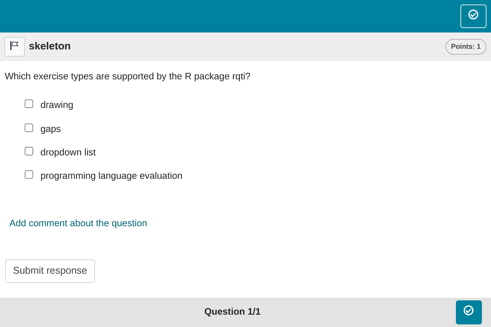
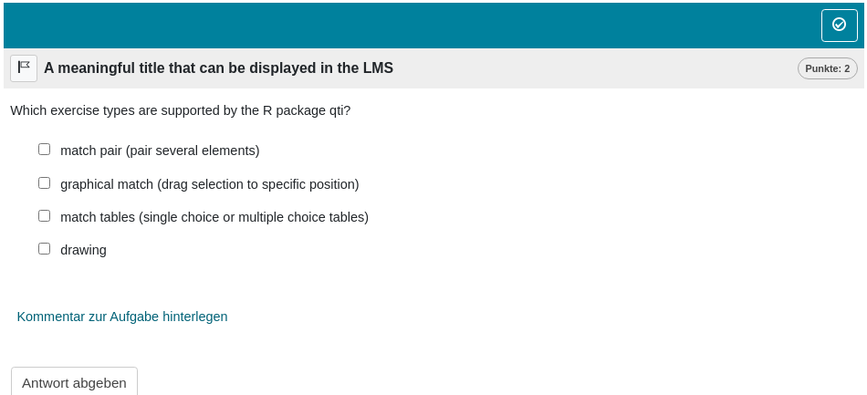

```{r mpc, include = FALSE}
knitr::opts_chunk$set(
  collapse = TRUE,
  comment = "#>"
)
source("helper.R")
```

```{r setup, echo=FALSE}
library(rqti)
```

`r if(knitr::is_latex_output()) "# Multiple-Choice tasks"`

This is just a normal multiple choice task. 

## Minimum version

A minimum template is automatically created when you initiate an rqti project through RStudio. Alternatively, it can be added by clicking on `New file -> R Markdown -> From Template`. The `rqti` templates end with `{rqti}`. Here we look at the templates `multiplechoice (simple)` and `multiplechoice (complex)`.

The minimum you need to provide is the `type: mpc` (or the equivalent `type: multiplechoice` or `type: mchoice`) in the YAML section and a list with at least two elements in a section called **\# question**:

```{r comment='', echo = F}
cat(readLines(system.file("rmarkdown/templates/multiplechoice-simple/skeleton",
                               "skeleton.Rmd",
                               package = "rqti")), sep = '\n')
```

Note that in this example, a feedback section was also provided. This is optional, but usually it is a good idea to give some explanation for students.

Further note that the `knit` parameter is set to the custom `rqti` knit function, which will handle the preview. Clicking the Knit button in RStudio produces`r ltx(" the output in Figure \\ref{mpc1qtijs}.", ":")`

{width=100%}

You can also use the OPAL (set it up before, see article \ref{working-with-the-opal-api} [Working with the OPAL API](api_opal.html)) render function (`knit: rqti::render_opal`), which should produce`r ltx(" the output in Figure \\ref{mpc1opal}.", ":")`

{width=100%}

Multiple-choice tasks function similarly to single-choice tasks, with the key difference being that multiple (or no) answers can be correct. To indicate the correct options, surround them with asterisks (using markdown for italics). If you need to use italics within the choices themselves, enclose the entire question in `<em></em>` tags to avoid conflicts.

For an Rmd item without an explicit `points` value, the default maximum is
0.5 times the number of **correct** options. Each selected correct option then
earns 0.5 points; penalties for selected incorrect options balance the total
positive credit. The default item score is floored at zero. These are the
default rules, not the only available scoring methods; see `scoring_scheme`
below for alternatives and `multiple_choice_scoring()` for its own help page.

## More control

If you want to have more fine-grained control, consider the available attributes for the YAML section in the Rmd template `multiple-choice (complex)`.

```{r comment='', echo = F}
cat(readLines(system.file("rmarkdown/templates/multiplechoice-complex/skeleton/", "skeleton.Rmd", package = "rqti")), sep = '\n')
```

Which renders in OPAL as`r ltx(" shown in Figure \\ref{mpc2opal}.", ":")`

{width=100%}

## YAML attributes

### type

Has to be `multiplechoice` or `mpc` or `mchoice` (compatible with `exams` package).

### identifier

This is the ID of the task, useful for later data analysis of results. The default is the file name. If you are doing extensive data analysis later on, it makes sense to specify a meaningful identifier. In all other cases, the file name should be fine.

### title

Title of the task. Can be displayed to students depending on the learning management system settings. The default is the file name.

### shuffle

If `true`, randomizes the order of the choices. Defaults to `true`. Only in rare occasions it makes sense to have a strict order of choices (setting shuffle to `false`).

### orientation

Should the items be displayed in `vertical` or `horizontal` mode? Default is `vertical`.

<!-- TODO, is this really possible? or do we always use points instead? -->
<!-- ### solution -->

<!-- An alternative way to specify the correct solution is by giving the integer of the correct choice. Usually not needed and less intuitive than specifying the correct choices directly in the list of all choices (see above). -->

### points

For an Rmd item, a scalar `points` sets the maximum for the task. If omitted,
the maximum is 0.5 times the number of correct options. In the S4 helper,
`multipleChoice(points = ...)` instead accepts a vector with one entry per
option. Positive entries identify the correct options and their sum is the
maximum P.

### scoring_scheme

The default `"standard"` uses **balanced scoring equivalent to Youden's J**,
with negative totals floored at zero. With equally weighted
correct options, C correct options and W incorrect options, both greater than
zero, the awarded score is

\[
P\max\left(0,
  \frac{\#\text{correct options selected}}{C}
  - \frac{\#\text{incorrect options selected}}{W}
\right).
\]

The raw normalized expression is Youden's J. It has zero expectation under independent
random selection. Flooring negative totals at zero means the awarded score
does not generally have zero expectation. If the S4 item supplies explicit
negative option weights, `standard` preserves those weights; use `weights`
to preserve explicit zero weights as well. Unequal correct-option weights or
custom penalties need not be equivalent to Youden's J. The formula above
applies to the ordinary automatically balanced default.

Use `multiple_choice_scoring()` to choose another multiple-response model:

| Method | Meaning |
|:-------|:--------|
| `standard` | Default balanced (Youden's J) mapping, with a zero floor; explicit weights are preserved |
| `weights` | Supplied option weights, including explicit zeros |
| `all_or_nothing` | Full credit only for selecting exactly the correct set |
| `plus_minus` | Equal positive and negative contributions for selected options |
| `subset` | Credit for selected correct options only if no incorrect option is selected |
| `ripkey` | Credit for selected correct options unless more than C options are selected |
| `true_false` | Credit for each correctly classified option, including unchecked incorrect options |
| `exams` | The R/exams partial-credit, weighting and score-floor settings |

For example, select plus/minus scoring in R:

```{r multiple-scoring}
mc <- multipleChoice(
  choices = c("A", "B", "C"), points = c(0.5, 0, 0.5),
  scoring_scheme = multiple_choice_scoring("plus_minus")
)
```

Or in YAML:

```yaml
scoring_scheme: plus_minus
```

Configurable methods accept a named mapping in YAML and named settings in R:

```{r multiple-exams-scoring}
mc_exams <- multipleChoice(
  choices = c("A", "B", "C"), points = c(0.5, 0, 0.5),
  scoring_scheme = multiple_choice_scoring(
    "exams", partial = TRUE, negative = -0.25, rule = "false2"
  )
)
```

```yaml
scoring_scheme:
  method: exams
  partial: true
  negative: -0.25
  rule: "false2"
```

`weights` and `plus_minus` accept `lower_bound`, a nonpositive fraction of P.
`all_or_nothing` accepts `incorrect` and `omitted` credits. The `exams` method
accepts all five weighting rules (`false2`, `false`, `true`, `all`, `none`),
`partial`, and `negative`. Quote the `"false"` and `"true"` rule names in YAML
so that they are parsed as strings rather than logical values.
See `?multiple_choice_scoring` for defaults and the full definitions.

The `true_false` method treats unchecked options as false decisions; a blank
selection can therefore earn credit for incorrect options left unchecked.
Checkboxes do not distinguish such a decision from an omission. This is a
different format from asking for an explicit true/false response to every
statement. The single-choice `kanzow_*` presets, and method 21's
`statement_truth` setting, belong to `single_choice_scoring()` and are not
accepted by `multiple_choice_scoring()`.

## Feedback

Feedback can be provided with the section

- **\# feedback** (general feedback, displayed every time, without conditions)
- **\# feedback+** (only provided if student reaches all points)
- **\# feedback-** (only provided if student does not reach all points)

## List of answers as a variable

For more complex tasks the list of answers is often just available as a variable. In this case you can use the helper function `mdlist` to convert the vector into a markdown list:

```{r results="plaintext", comment=""}
mdlist(c("dropdown list", "programming language evaluation", "numeric gap"), 
       solutions = c(1, 3))
```

## Some advice on multiple choice tasks

A multiple-choice task can always be converted into multiple single-choice questions with true/false or yes/no options. From a psychometric standpoint, both types of tasks share the same drawbacks, primarily due to the potential for guessing. Consequently, they should be avoided when possible. Generally, their psychometric properties are inferior to those of numeric or string-based gap tasks that assess similar content.

However, there are scenarios where forced-choice tasks are necessary. For example, presenting several statistical analyses and asking students to determine whether the results are statistically significant is a valuable task. Even in such cases, a multiple-choice format may not be the best option. Better alternatives include single-choice questions, dropdowns, or match tables. A multiple-choice question can often be restructured into several single-choice or dropdown questions with yes/no options. This may be cumbersome for longer multiple-choice lists, for which a match table with yes/no options can be a more convenient solution.

The main advantage of these alternative formats is that they require students to make explicit choices. In a multiple-choice task where all options are incorrect, a student could earn full points simply by not making any selections---effectively getting credit without engaging with the question. To avoid this, multiple-choice tasks must balance the distribution of correct and incorrect options, which is not necessary for single-choice, dropdown, or match table formats. 

While multiple-choice tasks are supported, we strongly advise against using them whenever possible in favor of more robust alternatives.
