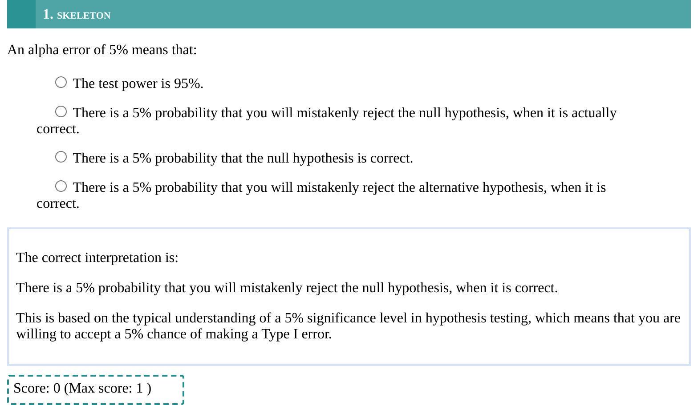
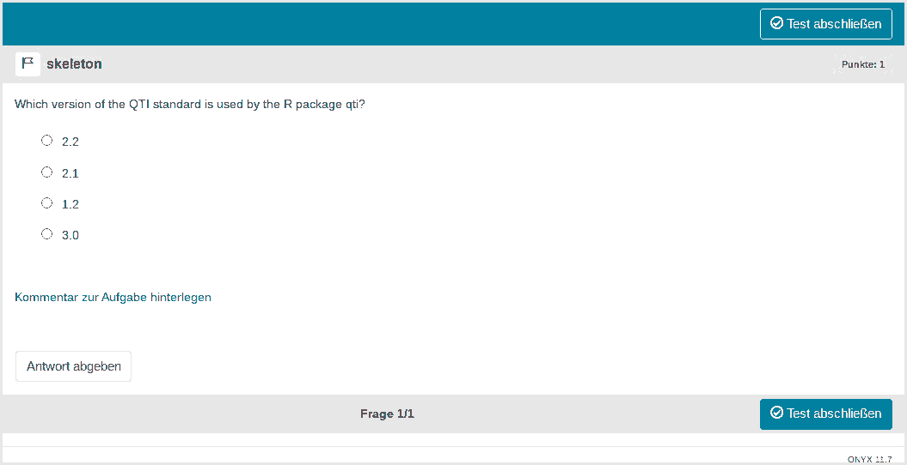
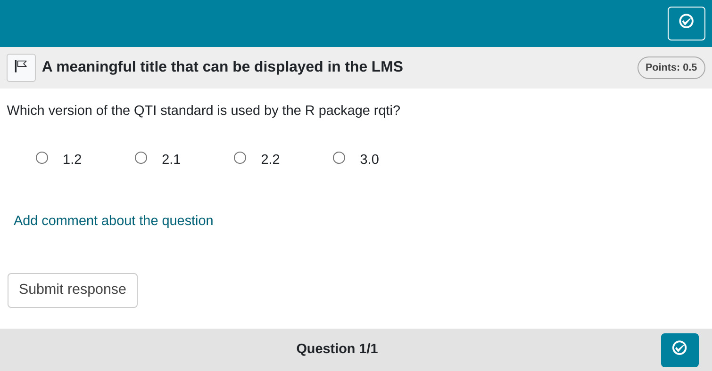

```{r sc, include = FALSE}
knitr::opts_chunk$set(
  collapse = TRUE,
  comment = "#>"
)
source("helper.R")
```

`r if(knitr::is_latex_output()) "# Single-Choice tasks"`

```{r setup sc, echo = F, message=F}
library(rqti)
```

Please note that this is the first type of task described in this manual, and as such, it may be more detailed than those that follow. Our goal is to emphasize key points that might not be as thoroughly covered in later articles. For this reason, we recommend reading through this article carefully before diving into the task types that most interest you.

## Minimum version

The simplest task type in the rqti package is single choice. A template is automatically created when you initiate an rqti project through RStudio. Alternatively, it can be added by clicking on `New file -> R Markdown -> From Template`. The `rqti` templates end with `{rqti}`. Here we look at the templates `singlechoice (simple)` and `singlechoice (complex)`.

The minimum you need to provide is the `type: sc` (or the equivalent `type: singlechoice`, or `type: schoice`) in the YAML section and a list with at least two elements in a section called **\# question**:

```{r scex1, comment='', echo = F}
cat(readLines(system.file("rmarkdown/templates/singlechoice-simple/skeleton", "skeleton.Rmd", package = "rqti")), sep = '\n')
```

Note that in this example, a feedback section was also provided. This is optional, but usually it is a good idea to give some explanation for students.

Additionally, note that the `knit` parameter is set to a custom `rqti` function, which streamlines the preview process. While this is optional, it significantly simplifies the workflow. Without it, the default preview will be a basic HTML file. By including our custom knit function, you will get a more realistic preview that allows for interaction with the task.

To preview the final result, simply click the *Knit* button in RStudio (if you are not using RStudio, call `render_qtijs` on the file). This will generate a QTI XML file and render it in the viewer pane using QTIJS. If you are not using RStudio, you can also open the server URL displayed in the console directly in your browser for the same preview experience.

<!-- {width=100%} -->

You can now interact with the task by selecting an option and then clicking `Submit` in the top right corner. By default, after submitting, the feedback and reached points are displayed`r ltx(" as shown in Figure \\ref{sc1qtijs}.", ":")`

{width=100%}

The corresponding xml file is created in the same folder as the Rmd file if you click the Knit-Button.
<!-- or in the current directory if you execute the functions from the console. Usually, the Knit button will be sufficient for most use cases, but if you need more control the functions `rmd2qti, render_xml, render_zip` are handy. The functions give a message about the path of the created file. -->

Many learning management systems can directly import a QTI-XML-file, so all you need to do is upload the generated file. Compositions of tasks are covered in the article \ref{sections-and-tests} [Sections and Tests](section.html).

If you happen to use OPAL/ONYX, you can also upload your tasks directly by modifying the knit parameter:

```{r scrender, eval=FALSE}
knit: rqti::render_opal
```

This will upload the file and open a browser with the OPAL url. It should look like `r ltx(" in Figure \\ref{sc1opal}.", "this:")`

{width=100%}

Setting up OPAL requires some additional steps, which are covered in the article \ref{working-with-the-opal-api} [Working with the OPAL API](api_opal.html).

By default the rights of the uploaded material in OPAL are set to public, so no authentication is required to view the material. Otherwise you have to login into OPAL, which will log you out in the API. Please take this into account when testing your material. Without changing the defaults anyone with the link has access to your task.

## Syntax explained

Let us have a closer look at the input file.

```{r comment='', echo = F}
cat(readLines(system.file("rmarkdown/templates/singlechoice-simple/skeleton", "skeleton.Rmd", package = "rqti")), sep = '\n')
```

Note that you do not necessarily need to specify which list element is correct. The first one is treated as the correct one, which is a useful shortcut. If you communicate this to your collaborators, it is also much easier to read. They do not need to look anywhere else in the file for checking the correct answer.

Of course you can specify the correct choice if need be. Our preferred way of doing this is by putting asterisks around this option. For instance:

```markdown
Choose the correct one:
  
- A
- B
- *C* <!-- treated as correct -->
- D
```

Once again, this is much easier to read than providing the solution somewhere else (e.g. in the YAML section). Furthermore, producing a preview as HTML directly shows you which element is correct. If you want to use italics in your choice, you can also wrap the correct solution in emphasis tags: `<em> a choice with *some italics*</em>`.

An important note: Do not forget to put a blank line before your question and the answer list, otherwise the list will not be a proper list:

```{verbatim}
A question text that is not separated by a blank line
- A
- B
- C
- D
```

Renders as:

> A question text that is not separated by a blank line - A - B - C - D

## More control

If you want to have more fine-grained control, consider the Rmd template `singlechoice-complex`, which uses more YAML attributes. In addition, you can also set feedback for correct and incorrect responses.

```{r comment='', echo = F}
cat(readLines(system.file("rmarkdown/templates/singlechoice-complex/skeleton", "skeleton.Rmd", package = "rqti")), sep = '\n')
```

Which renders in OPAL as`r ltx(" shown in Figure \\ref{sc2opal}.", ":")`

{width=100%}

Notably, the choices are now displayed horizontally, and the title and points have been updated. The next section provides a detailed explanation of all YAML attributes.

## YAML attributes

### type

Has to be `singlechoice` or `sc` (a shortcut for singlechoice) or `schoice` (compatible with `exams` package)

### identifier

This is the ID of the task, useful for later data analysis of results. The default is the file name. If you are doing extensive data analysis later on, it makes sense to specify a meaningful identifier. In all other cases, the file name should be fine.

### title

Title of the task. Can be displayed to students depending on the learning management system settings. Default is the file name.

### shuffle

If `true` (the default), randomizes the order of the choices. Only in rare occasions it makes sense to have a strict order of choices (setting shuffle to `false`).

### orientation

Should the items be displayed in `vertical` or `horizontal` mode? Default is `vertical`.
<!-- ### solution -->

<!-- An alternative way to specify the correct solution by giving the integer of the correct choice. Usually not needed and less intuitive than specifying the correct choice directly in the list of all choices (see above). Note that specifying `solution` will override the manual selection with asterisks. -->

### points

How many points are given for the correct solution under standard scoring. Default is 1. For custom rules and literature presets, `points` scales the scoring coefficients; see `scoring_scheme` below.

### calculator

If a calculator is required for this task, you need to assign the 'calculator' attribute the type 'simple' or 'scientific'. This only works on OPAL.

### files

If additional files are required to complete this task, you need to assign the 'files' attribute a single file path or a list of paths to these files. Keep these additional files in the same folder with Rmd. This only works on OPAL.

### scoring_scheme

If `scoring_scheme` is omitted, **standard scoring is used**, in both Rmd/YAML
and the `singleChoice()` function: a correct answer receives `points`, and an
incorrect or omitted answer receives zero. The default `points` is 1, giving
scores of 1/0/0. You can state this explicitly:

```yaml
scoring_scheme: standard
```

The original `penalty` scheme also remains available. It awards `points` for a
correct answer, `-points / (k - 1)` for an incorrect answer, and zero for an
omission, where `k` is the number of options. The option count is inferred from
the item; you do not supply it as a scoring parameter.

```yaml
scoring_scheme: penalty
```

Note that in Germany, the use of penalty scoring raises legal considerations; see, for example: https://nrwe.justiz.nrw.de/ovgs/ovg_nrw/j2008/14_A_2154_08urteil20081216.html

#### Custom scoring in R

`singleChoice()` accepts a scoring specification made by `single_choice_scoring()`.
For custom single-choice scoring, its parameters are:

| Parameter | Default | Meaning |
|:----------|--------:|:--------|
| `method` | `"custom"` | Use explicit credits for each response outcome |
| `correct` | 1 | Credit for selecting the correct answer |
| `incorrect` | 0 | Credit or penalty for selecting an incorrect answer |
| `omitted` | 0 | Credit or penalty for leaving the item unanswered |

The three credits are multiplied by the item's `points`. They must be finite;
`correct` must be positive, and the other credits cannot exceed `correct`.
The `solution` argument of `singleChoice()` identifies the correct option by
its position (the default is 1); it is separate from the scoring specification.

```{r custom-scoring}
sc <- singleChoice(
  identifier = "custom_single_choice",
  choices = c("A", "B", "C"),
  solution = 1,
  points = 2,
  scoring_scheme = single_choice_scoring(
    method = "custom", correct = 1, incorrect = -0.2, omitted = 0
  )
)
```

This item awards 2 points for A, -0.4 points for B or C, and zero for an
omission. Single-choice penalties remain negative; there is no zero floor.

`single_choice_scoring()` is a specification helper, not the function that selects
an item's default scoring rule. Its signature defaults to `method = "custom"`
so that `single_choice_scoring(incorrect = -0.2)` is a convenient equivalent of the
explicit custom specification above. Calling `single_choice_scoring()` without
settings gives coefficients 1/0/0, matching standard single-choice scoring.
Omitting `scoring_scheme` from `singleChoice()` still selects `"standard"`.

#### The equivalent Rmd/YAML form

Use a named YAML mapping for the same settings. Do not put an R function call
inside the YAML field:

```markdown
---
type: sc
points: 2
scoring_scheme:
  method: custom
  correct: 1
  incorrect: -0.2
  omitted: 0
---

# question

Choose the correct answer.

- *A*
- B
- C
```

The emphasized answer marks the correct option. The YAML mapping and the R
specification above produce the same scoring rule.

#### R/exams single-choice penalties

The `exams` method follows the `negative` setting of `exams::exams_eval()`:

| `negative` | Correct | Incorrect | Omitted |
|:-----------|--------:|----------:|--------:|
| `FALSE` (default) | P | 0 | 0 |
| `TRUE` | P | -P | 0 |
| Numeric d | P | -abs(d) * P | 0 |

Here P is the item's `points`. For example,
`single_choice_scoring("exams", negative = 0.25)` awards 2 points for a
correct answer and -0.5 for an incorrect answer when `points = 2`.
It is equivalent to `single_choice_scoring(incorrect = -0.25)`.
This is a parameter convention used by R/exams, not an additional grading
formula. The magnitude is supplied by the author; it is not automatically
computed from the number of options as in `scoring_scheme = "penalty"`.

#### Literature presets and restrictions

A preset can be supplied as a method name in either interface:

```{r preset-scoring}
sc_preset <- singleChoice(
  choices = c("A", "B", "C"),
  scoring_scheme = "kanzow_05"
)
```

```yaml
scoring_scheme: kanzow_05
```

`single_choice_scoring("kanzow_05")` and a YAML mapping containing
`method: kanzow_05` are equivalent ways to select the same preset.
The identifiers `kanzow_01` through `kanzow_21` refer to Table 2 of
[Kanzow et al. (2023)](https://mededu.jmir.org/2023/1/e44084/).
The aliases `number_right`, `fair_penalty`, `correction_for_guessing`, and
`rights_minus_wrongs` select methods 1, 3, 6, and 13, respectively.
See `?single_choice_scoring` for the complete coefficient table.

Methods **10, 12, 14, 15, 17, 18, and 20 require exactly two options**.
Using one with three or more options raises an **error** when the item is
constructed or the Rmd file is converted; the rule is not silently changed.
For example:

```{r restricted-preset, error=TRUE}
singleChoice(choices = c("A", "B", "C"), scoring_scheme = "kanzow_10")
```

Method 21 additionally requires a true/false statement and an explicit
`statement_truth`. This is the assertion's **actual truth**, not the student's
answer. For example, "2 + 2 = 4" needs `statement_truth = TRUE`; "2 + 2 = 5"
needs `FALSE`. Method 21 penalizes misclassifying a true assertion by 62/38
points and misclassifying a false assertion by 38/62 points for a one-point
item. Correct answers score 1 and omissions score 0. No other preset needs
this setting. The displayed answer order is separate: `solution` still
identifies which option is correct. For example:

```{r true-false-preset}
sc_true_false <- singleChoice(
  prompt = "2 + 2 = 4",
  choices = c("False", "True"), solution = 2,
  scoring_scheme = single_choice_scoring("kanzow_21", statement_truth = TRUE)
)
```

```yaml
scoring_scheme:
  method: kanzow_21
  statement_truth: true
```

For all presets, `points` scales the published coefficients. Methods 4, 7, and 8
can therefore have a maximum different from `points`; `getPoints()` reports
the actual maximum. Including a preset does not recommend it for every use.

## Feedback

Feedback can be provided with the section

-   **\# feedback** (general feedback, displayed every time, without conditions)
-   **\# feedback+** (only provided if student reaches all points)
-   **\# feedback-** (only provided if student does not reach all points)

We typically prefer providing comprehensive feedback rather than conditional feedback. Basically, we never use feedback+ and feedback-. It is often more effective to present the entire solution, organized into manageable chunks that users can expand or collapse, such as HTML elements with `<details>` and `<summary>` tags. To give an example:

```html
<details><summary>Question1</summary>
  Provide Feedback for Question 1
</details>
<details><summary>Question 2</summary>
  Provide Feedback for Question 2
</details>
```

will render as:

```{=html}
<details><summary> Question 1</summary>
  Provide Feedback for Question 1
</details>
<details><summary> Question 2</summary>
  Provide Feedback for Question 2
</details>
```

```{=latex}
\textrightarrow{} Question 1\\
\textrightarrow{} Question 2\\
```

By clicking on the arrows, the details will unfold. Thus, there is no need to go beyond using the general feedback.

## List of answers as a variable

For more complex tasks the list of answers is often just available as a variable. In this case you can use the helper function `mdlist` to convert the vector into a markdown list:

```{r results="plaintext", comment=""}
mdlist(c(1.2, 2.1, 2.2, 3.0), solutions = 2)
```

<!-- make a separate vignette for this -->

<!-- ## A programatic low level approach -->

<!-- The `rqti` package is very flexible in that you can also use low level functions to create rqti content. Let us say you have a csv table with many single choice tasks. It is quite easy to transform this to a rqti section: -->

## Some advice on single choice tasks

From a psychometric standpoint, single-choice tasks are often the least effective option for assessing ability. This is primarily because guessing cannot be entirely ruled out, leading to weaker psychometric properties compared to similar content presented in gap tasks.

For example, the `exams` package, an alternative R package for test creation, frequently converts numeric gaps into single-choice tasks. However, we believe this approach is justified only when the learning management system either does not support gap tasks, provides inadequate support, or the instructor requires printed exams with automated grading. In all other cases, using numeric or string gaps is generally more effective.

In some cases, single-choice tasks may be unavoidable. For instance, when determining whether a statistical test is significant, there are only two possible answers. In such situations, we suggest asking multiple related questions rather than relying on a single one. Additionally, assigning fewer points to single-choice tasks can help mitigate the effects of guessing.

If you have multiple single-choice tasks with identical answer options, consider using a match table instead (see article \ref{table-tasks} [Table tasks](table.html)).

In conclusion, it is advisable to avoid single-choice tasks whenever possible. Specifically, refrain from converting numeric gap tasks into single-choice format unless absolutely necessary. If single-choice tasks are unavoidable, consider asking multiple related questions or using a match table. Additionally, reducing the weight of single-choice tasks in the overall grading can help create a more balanced and fair assessment.
